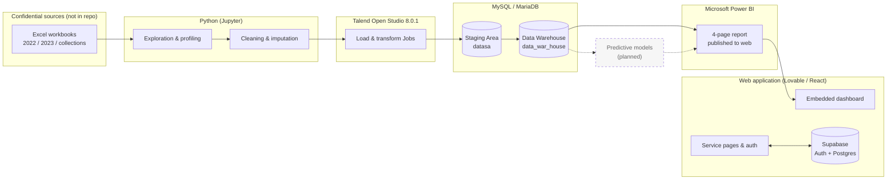
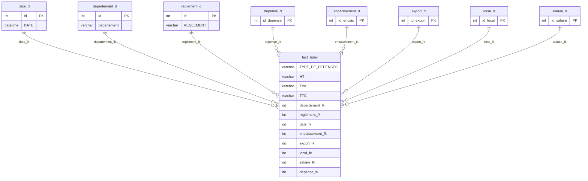
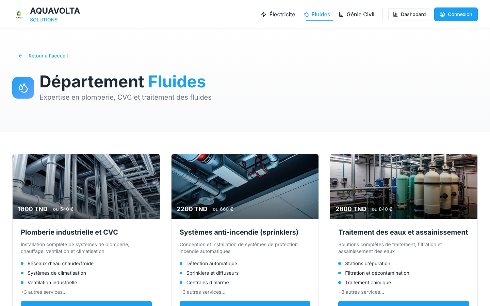

# AQUAVOLTA SOLUTION — Dynamic Financial Analysis & Business Intelligence Platform

> AQUAVOLTA SOLUTION is an end-to-end Business Intelligence platform for dynamic financial analysis. It combines Python-based data exploration, Talend ETL, a MySQL Staging Area and Data Warehouse, Power BI dashboards, and a Lovable-generated web application to support financial monitoring and profitability analysis.

**Live Power BI dashboard:** [open the published report](https://app.powerbi.com/view?r=eyJrIjoiZWNjNjk5YWQtYThlOC00YmQwLWExNWYtZGQxMzkzMDEzOTYyIiwidCI6ImRiZDY2NjRkLTRlYjktNDZlYi05OWQ4LTVjNDNiYTE1M2M2MSIsImMiOjl9)

**Live web application:** <https://aquavolta-solution.lovable.app> (hosted by Lovable)

> **Predictive analytics status:** `Planned — Future Development Phase`. No forecasting model has been trained and no prediction result is published in this repository. See the [roadmap](docs/roadmap.md).

---

## Table of contents

1. [Project overview](#1-project-overview)
2. [Business context and objectives](#2-business-context-and-objectives)
3. [Main features](#3-main-features)
4. [Technology stack](#4-technology-stack)
5. [System architecture](#5-system-architecture)
6. [End-to-end data pipeline](#6-end-to-end-data-pipeline)
7. [Python exploration and cleaning](#7-python-exploration-and-cleaning)
8. [Talend ETL](#8-talend-etl)
9. [MySQL Staging Area and Data Warehouse](#9-mysql-staging-area-and-data-warehouse)
10. [Data model and relationships](#10-data-model-and-relationships)
11. [Power BI dashboard](#11-power-bi-dashboard)
12. [Screenshots](#12-screenshots)
13. [Installation and execution](#13-installation-and-execution)
14. [Configuration and database setup](#14-configuration-and-database-setup)
15. [Security and data privacy](#15-security-and-data-privacy)
16. [Implemented vs. planned features](#16-implemented-vs-planned-features)
17. [Known limitations](#17-known-limitations)
18. [Roadmap](#18-roadmap)
19. [Repository structure](#19-repository-structure)

---

## 1. Project overview

This repository documents a real academic/professional BI project built on two years (2022–2023) of financial data from a company operating in technical electricity and fluid services. The data covers export and local revenue, expenses, payroll, collections and foreign-exchange losses.

The work spans the full decision-support chain: source workbooks are explored and cleaned in Python, integrated with Talend into a MySQL staging database, modelled in a MySQL data warehouse, and analysed in a four-page Power BI report. A React web application generated with Lovable.dev presents the company's services and embeds the published Power BI report.

Because the underlying data is confidential, **this public repository contains code, structure and documentation only** — no source workbook, no data row and no Power BI file. See [Security and data privacy](#15-security-and-data-privacy).

## 2. Business context and objectives

Management needs to analyse profitability by department, client, year and geography while optimising cash flows. The specification (*Cahier des charges — « Analyse Financière Dynamique »*) sets three objectives:

- **Centralise and make reliable** the financial data: revenue, expenses, salaries, bank flows, foreign-exchange losses.
- **Analyse profitability dynamically** by service, client, year and geographic zone.
- **Provide a forecasting capability** to anticipate future financial flows — *planned, not yet implemented*.

Analysis scope: revenue (local/export, by country, client, department, 2022 vs 2023), expenses (supplier, department, type, HT/TVA/TTC, payment method), payroll (net salary, CNSS, fiscal charges, total cost, bank), and collections (collected vs outstanding, client balances, FX losses by bank and country). Details: [docs/business-requirements.md](docs/business-requirements.md) and [docs/kpi-catalog.md](docs/kpi-catalog.md).

## 3. Main features

- **Data quality workflow in Python** — profiling, missing-value analysis, duplicate checks, outlier detection, date normalisation and imputation across four notebooks.
- **Two-layer MySQL storage** — a staging database (`datasa`, 16 tables) and a data warehouse (`data_war_house`, 9 tables) with a central fact table linked by eight foreign keys.
- **Power BI report** — four pages (*Accueil*, *Produit*, *Charge*, *Résultat*) with slicers, cards, gauges, a map and time-series visuals, published to the web.
- **Web application** — React + TypeScript single-page app with Supabase authentication, service-request forms, and the Power BI report embedded in a full-screen dialog.

## 4. Technology stack

| Layer | Technology | Purpose |
|---|---|---|
| Frontend | React 18, TypeScript, Vite 5, Tailwind CSS, shadcn/ui (generated with Lovable.dev) | Interactive application, Power BI embed |
| Backend-as-a-service | Supabase (Auth + PostgreSQL with Row Level Security) | User accounts, profiles, service requests |
| Data exploration | Python, Pandas, NumPy, Matplotlib, Seaborn, missingno, scikit-learn | Exploration, cleaning, imputation |
| ETL | Talend Open Studio for Data Integration 8.0.1 | Loading and transformation |
| Database | MySQL / MariaDB 10.4 | Staging Area and Data Warehouse |
| Visualization | Microsoft Power BI | Interactive financial dashboards |
| Version control | Git and GitHub | Source code and documentation |

## 5. System architecture



Full description: [docs/architecture.md](docs/architecture.md).

## 6. End-to-end data pipeline

`Excel sources → Python exploration & cleaning → Talend ETL → MySQL Staging Area → MySQL Data Warehouse → Power BI dashboard → Web application embed`

| Step | Input | Output | Evidence in this repo |
|---|---|---|---|
| 1. Exploration & cleaning | Excel sheets `EXPORT`, `LOCAL`, `DEPENSES`, `SALAIRES`, `ENCAISSEMENTS` | Cleaned `OUTPUT_*.xlsx` workbooks | `analytics/notebooks/` |
| 2. Staging load | Cleaned workbooks | Per-year tables and unified `*_sa` tables in `datasa` | `database/staging/datasa_schema.sql` |
| 3. Warehouse load | Staging tables | `*_d` tables and `fact_tabel` in `data_war_house` | `database/warehouse/data_war_house_schema.sql` |
| 4. Reporting | Warehouse tables | Power BI report | `powerbi/README.md` |

Step-by-step detail: [docs/data-pipeline.md](docs/data-pipeline.md).

## 7. Python exploration and cleaning

Four notebooks in [`analytics/notebooks/`](analytics/notebooks/) (outputs stripped, paths made portable):

| Notebook | Scope | Techniques actually implemented |
|---|---|---|
| `2022.ipynb` | Export, local, expenses, payroll 2022 | `info`/`describe` profiling, `missingno` bar charts, box plot, IQR and z-score outlier detection, duplicate count, log-transform histogram, mode imputation of client name, date formatting, department label harmonisation |
| `2023.ipynb` | Export, local, expenses, payroll 2023 | Client-level collection-ratio imputation, custom date repair function, recomputation of TVA (19 %) and TTC, mode imputation, date formatting, label harmonisation |
| `encaissement.ipynb` | Collections | Mode imputation (bank), **`IterativeImputer` with `BayesianRidge`** on numeric columns, date repair |
| `looktest.ipynb` | Detailed expenses | `missingno` matrix/bar/dendrogram/heatmap, missing-value table, row drop on missing invoice number, mean imputation (HT), VAT-rate correction to legal rates (7/13/19 %), **`SimpleImputer(most_frequent)`**, TTC and net-of-withholding recomputation |

`KNNImputer` and `IsolationForest` are imported but **not applied** in the current notebooks. Methodology and caveats: [analytics/README.md](analytics/README.md).

## 8. Talend ETL

The project was built with **Talend Open Studio for Data Integration 8.0.1** (project name `DATAWARHOUSE`). The archive supplied for this repository contained only project-level settings — **no Job definitions** — so no Talend Job is published here and none is described beyond what the database structures show. The exact files to export are listed in [etl/README.md](etl/README.md).

## 9. MySQL Staging Area and Data Warehouse

| Database | Role | Tables |
|---|---|---|
| `datasa` | Staging Area | Per-year landing tables (`depense2022/2023`, `export2022/2023`, `local2022/2023`, `salaires__2022/2023`), unified tables (`depense_sa`, `export__sa`, `local_sa`, `salaire_sa`, `encaissement`), reference tables (`date__sa`, `departement_sa`, `reglement_sa`) |
| `data_war_house` | Data Warehouse | `date_d`, `departement_d`, `reglement_d`, `depense_d`, `encaissement_d`, `export_d`, `local_d`, `salaire_d`, `fact_tabel` |

Structure-only scripts (every `INSERT` removed) are in [`database/`](database/). Column-level documentation: [docs/data-dictionary.md](docs/data-dictionary.md).

## 10. Data model and relationships



The implemented warehouse is a **star-shaped schema with one central fact table**, which differs from the model in the specification (three fact tables `F_CA`, `F_Dépenses`, `F_Salaires` and dimensions `Dim_Clients`, `Dim_Projets`, `Dim_Fournisseurs`, `Dim_Temps`, `Dim_Pays`). Clients, suppliers and countries are currently attributes of the `*_d` tables rather than separate dimensions. The differences are listed in [database/README.md](database/README.md).

## 11. Power BI dashboard

**Published report:** <https://app.powerbi.com/view?r=eyJrIjoiZWNjNjk5YWQtYThlOC00YmQwLWExNWYtZGQxMzkzMDEzOTYyIiwidCI6ImRiZDY2NjRkLTRlYjktNDZlYi05OWQ4LTVjNDNiYTE1M2M2MSIsImMiOjl9>

| Page | Content (visual types found in the report file) |
|---|---|
| **Accueil** | KPI cards, pie and donut charts, line chart, Azure map, slicers, page navigator |
| **Produit** | KPI cards, gauges, clustered bar chart, line charts, pie chart, slicers |
| **Charge** | KPI cards, pie and donut charts, slicers |
| **Résultat** | KPI cards, slicers |

The `.pbix` file is not published because it embeds an imported copy of the data. See [powerbi/README.md](powerbi/README.md).

## 12. Screenshots

Web application (captured from a local production build):

| Landing page | Service catalogue | Sign-in |
|---|---|---|
|  |  |  |

No Power BI screenshot is committed: the report displays real company figures, so captures must first be reviewed or taken from anonymised data. The live report is available through the link in [section 11](#11-power-bi-dashboard).

## 13. Installation and execution

**Prerequisites:** Node.js 18+ and npm, Python 3.10+, MySQL 8 or MariaDB 10.4+, Talend Open Studio 8.0.1 (to open the Jobs once exported), Power BI Desktop (Windows) for the report.

```bash
git clone https://github.com/Edambi12/aquavolta-bi-platform.git
cd aquavolta-bi-platform
```

**Web application**

```bash
cd app
cp .env.example .env      # then fill in your Supabase values
npm ci
npm run dev               # http://localhost:8080
npm run build             # production bundle in app/dist
```

**Notebooks**

```bash
python -m venv .venv && source .venv/bin/activate
pip install -r analytics/requirements.txt
export AQUAVOLTA_DATA_DIR=/path/to/confidential/workbooks
jupyter notebook analytics/notebooks
```

The notebooks require the original workbooks, which are not distributed.

## 14. Configuration and database setup

Environment variables are documented in [`.env.example`](.env.example) (placeholders only).

```bash
mysql -u root -p -e "CREATE DATABASE datasa; CREATE DATABASE data_war_house;"
mysql -u root -p datasa         < database/staging/datasa_schema.sql
mysql -u root -p data_war_house < database/warehouse/data_war_house_schema.sql
```

This creates empty structures. Loading them requires the confidential workbooks and the Talend Jobs. The web application's own tables (profiles, departments, service requests) are defined in `app/supabase/migrations/` and apply to a Supabase project, not to MySQL.

## 15. Security and data privacy

- No source workbook, SQL data row, Power BI file, salary, client, supplier or employee record is committed.
- SQL scripts are structure-only; notebooks are stripped of every output; two client names hard-coded in notebook cells were replaced with placeholders.
- No `.env` file or credential is committed; `.env.example` holds placeholders only.
- A strict [`.gitignore`](.gitignore) blocks spreadsheets, dumps, `.pbix` files, archives and secrets.

Audit details and the access-control requirements of the specification: [docs/security-and-privacy.md](docs/security-and-privacy.md).

## 16. Implemented vs. planned features

| Area | Status |
|---|---|
| Data collection and exploration (Python) | Implemented |
| Cleaning and imputation (Python: mode, mean, `SimpleImputer`, `IterativeImputer`) | Implemented |
| `KNNImputer`-based cleaning (required by the specification) | Not applied yet (imported only) |
| Staging Area (MySQL `datasa`) | Implemented |
| Data Warehouse (MySQL `data_war_house`) | Implemented — simplified single-fact model |
| Dedicated client / supplier / country / project dimensions | Planned |
| Power BI report (4 pages) and public publication | Implemented |
| Web application with authentication and dashboard embed | Implemented |
| Role-based access to sensitive data (finance / management / HR) | Planned |
| KPI thresholds, alerts and simulation | Planned |
| Predictive analytics (financial flows, FX losses) | **Planned — Future Development Phase** |

## 17. Known limitations

- **Talend Jobs are not in the repository** — only the project name and version are known from the supplied archive.
- Most monetary columns are stored as `VARCHAR(255)` in both databases; numeric typing is handled downstream.
- `fact_tabel` has no primary key and, in the supplied export, holds far fewer rows than the `*_d` tables; the Power BI visuals reference the `*_d` tables directly.
- `date_d` holds a single `DATE` column; year/quarter/month come from Power BI date hierarchies.
- There is no project identifier in the source data, so the *per-project* KPIs of the specification can only be approximated by client, department or business deal (`AFFAIRE`).
- The published Power BI link is a public "Publish to web" link: anyone holding the URL can view the report.
- The frontend linter reports style errors in generated code (mostly `no-explicit-any`); type-checking and the production build succeed.

## 18. Roadmap

See [docs/roadmap.md](docs/roadmap.md). Headline items: export and version the Talend Jobs, refine the dimensional model, add role-based security, then deliver the predictive phase (time-series forecasting of financial flows and of foreign-exchange losses).

## 19. Repository structure

```text
aquavolta-bi-platform/
├── app/                     # Lovable-generated React application (actual source)
│   ├── src/                 # pages, components, hooks, Supabase client
│   └── supabase/            # Supabase config and SQL migrations
├── analytics/
│   ├── notebooks/           # 4 sanitized Jupyter notebooks
│   ├── requirements.txt
│   └── README.md
├── etl/
│   ├── talend/              # reserved for exported Talend Jobs
│   └── README.md
├── database/
│   ├── staging/             # datasa_schema.sql (structure only)
│   ├── warehouse/           # data_war_house_schema.sql (structure only)
│   └── README.md
├── powerbi/
│   └── README.md
├── docs/                    # architecture, requirements, dictionary, pipeline, KPIs, security, roadmap
├── screenshots/             # web application captures
├── .env.example
├── .gitignore
└── README.md
```

No license file is included: the project relies on confidential company data and no license has been chosen by the author. All rights reserved unless stated otherwise.
