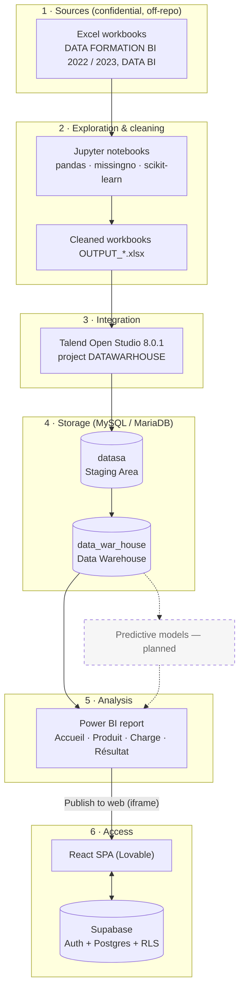

# Architecture

## Overview

The platform is a classic batch BI chain with a separate web front end.

## Layers

| Layer | Component | Responsibility |
|---|---|---|
| Sources | Excel workbooks | Export revenue, local revenue, expenses, payroll, collections |
| Exploration | Python notebooks | Profiling, quality diagnosis, cleaning, imputation, normalised output files |
| Integration | Talend | Loading cleaned files to staging, consolidating years, feeding the warehouse |
| Staging | MySQL `datasa` | Raw yearly tables, unified tables, reference tables |
| Warehouse | MySQL `data_war_house` | Analysis-ready tables and a central fact table |
| Analysis | Power BI | Measures, slicers, four report pages |
| Access | React application | Company service pages, authentication, embedded report |

## Web application

- **Framework:** React 18 + TypeScript, built with Vite 5; UI with Tailwind CSS and shadcn/ui (Radix primitives); routing with React Router; data fetching helpers from TanStack Query.
- **Backend:** Supabase. Authentication by email/password and OAuth (Google, GitHub). Tables `profiles`, `departements`, `donnees_utilisateur` protected by Row Level Security policies defined in `app/supabase/migrations/`.
- **Dashboard integration:** the header's *Dashboard* button opens a dialog containing an `<iframe>` pointing at the published Power BI report.

The web application and the BI chain are **decoupled**: the application does not query MySQL. Its only link to the BI layer is the embedded report URL. Its Supabase database stores application data (user profiles and service requests), not financial data.

| Route | Access | Purpose |
|---|---|---|
| `/` | Public | Landing page: hero, services, testimonials |
| `/electricite`, `/fluides`, `/genie-civil` | Public (submitting requires sign-in) | Department service catalogues and quote-request forms |
| `/auth` | Public | Sign-in / sign-up |
| `/dashboard` | Authenticated | User profile |
| `/data-view` | Authenticated | The user's submitted service requests |

## Extension point for predictive analytics

Predictive analytics is `Planned — Future Development Phase`. The intended integration keeps the current chain unchanged:

1. Python reads history from the warehouse (`export_d`, `local_d`, `depense_d`, `salaire_d`, `encaissement_d`).
2. Models write forecasts to **new, dedicated tables** (for example `forecast_flux`, `forecast_perte_change`) with model name, training date and horizon.
3. Power BI adds a forecast page reading those tables, visually separated from actuals.

Nothing of this exists yet; the dashed elements in the diagrams mark it as future work.
