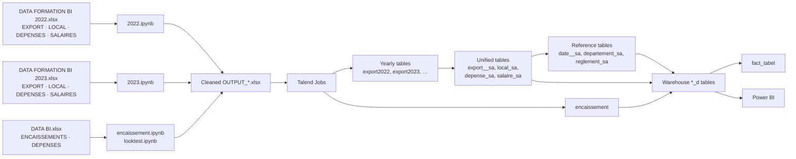

# Data pipeline

`Excel sources → Python exploration & cleaning → Talend ETL → MySQL Staging Area → MySQL Data Warehouse → Power BI dashboard`

## Step 1 — Extraction

Three Excel workbooks. Sheets are read with pandas; header rows sit at different offsets (row 3, 5 or 7 depending on the sheet), which the notebooks handle with the `header` argument.

## Step 2 — Exploration and cleaning (Python)

One notebook section per sheet: profile → diagnose (missing values, duplicates, outliers) → fix → normalise dates and labels → write a cleaned workbook. See [analytics/README.md](../analytics/README.md) for every technique used.

Outputs: nine cleaned workbooks, one per sheet and year, plus collections and detailed expenses.

## Step 3 — Staging load (Talend → `datasa`)

- **Landing:** each cleaned workbook is loaded to its own table. Types at this stage are permissive (mostly `varchar`).
- **Consolidation:** the 2022 and 2023 tables of each domain are merged into `*_sa` tables with a new surrogate key and `datetime` dates.
- **Reference data:** distinct dates, departments and payment methods are extracted to `date__sa`, `departement_sa`, `reglement_sa`.

## Step 4 — Warehouse load (Talend → `data_war_house`)

- Each unified staging table is loaded to its `*_d` counterpart with identical columns.
- `fact_tabel` is populated with expense measures and foreign keys to the eight `*_d` tables.

## Step 5 — Reporting (Power BI)

Power BI imports the warehouse tables, defines measures and calendar hierarchies, and exposes four report pages. The report is published to the web and embedded in the web application.

## Verified vs. inferred

| Statement | Basis |
|---|---|
| Sheets, cleaning logic, output file names | Verified in notebook code |
| Staging and warehouse structures, keys | Verified in the SQL exports |
| Tables and fields used by the report | Verified in the report layout |
| Talend performs steps 3–4 | Stated by the specification and the project author; **Job definitions were not available**, so component-level logic is not documented |
| Order of operations inside steps 3–4 | Inferred from table structures |

## Operations requiring a local environment

| Operation | Requires |
|---|---|
| Re-running the notebooks | The confidential workbooks |
| Creating the databases | MySQL 8 / MariaDB 10.4+ and the scripts in `database/` |
| Loading the databases | The cleaned workbooks and the Talend Jobs |
| Refreshing the report | The loaded warehouse, Power BI Desktop, the `.pbix` file |

## Data quality controls

Controls present today are the diagnostic steps in the notebooks. Not yet in place: row-count reconciliation between source, staging and warehouse; rejected-row handling; load logging. These are listed in the [roadmap](roadmap.md).
