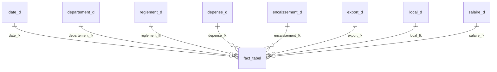
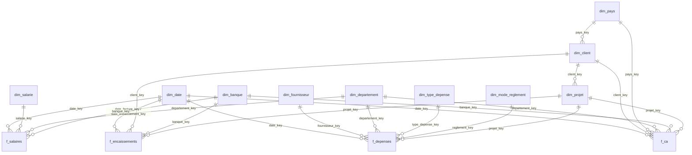

# Data warehouse — architecture review and target model proposal

> **Status of this document.** Sections 1–3 describe and assess what exists. Sections 4–7 are a **proposal**. Nothing proposed here is deployed: the current schema, the Talend Jobs and the Power BI report are unchanged. The proposed DDL lives in `database/proposal/target_star_schema.sql` and must be created in a separate database.

## 1. Current implementation (`data_war_house`)

- One table named as a fact, `fact_tabel`, holding expense measures (`HT`, `TVA`, `TTC`), an expense label and eight nullable foreign keys. No primary key.
- Three genuine dimensions: `date_d`, `departement_d`, `reglement_d`.
- Five `*_d` tables that are in reality **transaction tables**: one row per invoice, expense, payslip or collection, with their own measures.
- Client, supplier, country, bank and employee are text columns inside those transaction tables.
- Power BI reads the `*_d` tables directly; no visual uses `fact_tabel`.

## 2. Model in the specification

Facts `F_CA`, `F_Dépenses`, `F_Salaires`; dimensions `Dim_Clients`, `Dim_Projets`, `Dim_Fournisseurs`, `Dim_Temps` (year, month, quarter), `Dim_Pays`.

## 3. Comparison

| Criterion | Current single-fact structure | Specification (three facts, conformed dimensions) |
|---|---|---|
| Build effort | Low: tables mirror the cleaned sheets | Higher: dimension lookups and key management in the ETL |
| Fit with the sources | Direct, one table per sheet | Requires normalising labels (clients, countries, suppliers) |
| Fact grain | **Undefined.** A row of `fact_tabel` points simultaneously to an expense, a payslip, an export invoice, a local invoice and a collection, which are unrelated events. The row count is far below that of the tables it references | One explicit grain per fact: invoice, expense line, employee-month |
| Additivity | Measures are text; expense measures are duplicated between `fact_tabel` and `depense_d`. Joining through `fact_tabel` multiplies or drops rows | Typed additive measures, each stored once |
| Cross-process analysis (revenue vs expenses vs payroll) | Only through Power BI relationships between transaction tables on free-text columns | Drill-across through shared dimensions (date, department, client) |
| Filtering by client / country / supplier | On text columns; spelling variants split a member (`France` / `france`) | On dimension keys; one member per entity |
| Time intelligence | `date_d` has one column; hierarchies are generated in Power BI | Calendar attributes stored once and shared by all facts |
| Referential integrity | Declared only on `fact_tabel`; the tables actually used for reporting have none | Every fact row references existing dimension members |
| Data typing | Amounts and rates as `VARCHAR(255)`; decimal commas present | `DECIMAL` amounts, validated at load |
| Change over time | No history of dimension attributes | Possible (slowly changing dimensions) if needed later |
| Security | Employee names sit beside salaries in one table | Employee dimension can be restricted; payroll exposed through aggregates |
| Power BI model | Works today; relies on bidirectional or text relationships | Standard star: one-to-many, single direction, simpler DAX |

**Assessment.** The current structure was a pragmatic way to get a working report, and it does work for the present pages. Its weaknesses are structural rather than cosmetic: the fact table has no grain and is not used, the reporting tables carry no integrity constraint, and text-typed amounts push validation into Power BI. These points directly limit several KPIs of the specification (per-client and per-country shares, drill-across profitability) and made the F1 error in `analytics/calculation-audit.md` invisible to the database.

## 4. Recommendation

Adopt the specification's model, refined on four points, and build it **beside** the current warehouse:

1. **Four facts instead of three.** Add `f_encaissements`, because collections are a distinct business process with their own dates, and the collection-delay KPI needs both the invoice date and the collection date.
2. **`f_ca` unifies local and export sales** with a `type_vente` attribute and amounts converted to TND, so that total revenue is one additive measure.
3. **Additional conformed dimensions** already present in the data: department, bank, payment method, expense type, employee.
4. **`dim_projet` is created but points to an "unknown" member** until the business provides a project identifier. Per-project KPIs remain unavailable until then; the model does not pretend otherwise.

### Proposed model

### Fact grains

| Fact | Grain (one row =) | Main measures | Source |
|---|---|---|---|
| `f_ca` | one sales invoice | revenue HT/TVA/TTC in TND, revenue in currency, collected, outstanding, FX loss | `export__sa`, `local_sa` |
| `f_encaissements` | one collection event on an invoice | invoiced TND, payment TND, bank charges | `encaissement` |
| `f_depenses` | one expense line | HT, TVA, TTC | `depense_sa` |
| `f_salaires` | one employee for one pay month | net salary, CNSS, tax, meal vouchers, total cost | `salaire_sa` |

### Design rules

| Topic | Rule |
|---|---|
| Surrogate keys | `INT UNSIGNED AUTO_INCREMENT` on every dimension, assigned by the warehouse, never reused. Key `1` is the "unknown" member, so fact foreign keys are never `NULL` |
| Business keys | Kept in the dimension with a `UNIQUE` constraint (normalised label or code) to make lookups deterministic |
| Date dimension | `date_key` as `YYYYMMDD` integer; attributes year, quarter, month, month name, day, year-month; generated for the full range 2022-01-01 → end of the forecast horizon, not derived from the transactions |
| Role-playing dates | `f_encaissements` references `dim_date` twice (invoice, collection) |
| Numeric types | Amounts `DECIMAL(15,3)` (the dinar has three decimals); rates `DECIMAL(12,6)`; no amount stored as text |
| Currency | Export revenue kept in original currency **and** in TND with the rate used |
| Referential integrity | `FOREIGN KEY` on every fact key; loads run dimensions first, then facts |
| Lineage | `source_table` / `source_id` on every fact row, with a `UNIQUE` constraint that makes reloads idempotent |
| Imputation flags | `recouvrement_impute`, `client_impute`, `paiement_impute` mark values estimated during cleaning, so that reports can include or exclude them |
| Degenerate dimensions | Invoice number stays in the fact |
| Personal data | Employee name isolated in `dim_salarie`; an aggregated view `v_salaires_par_departement` serves non-HR users |

### What the proposal does not solve

- Expenses and payroll cannot be attributed to a client or a project with the current sources. Per-client and per-project **profitability** stays out of reach until that link exists in the data.
- Budget data is absent; actual-versus-budget KPIs are unchanged.
- A new model does not repair data: the findings of the calculation audit must be settled first.

## 5. Migration roadmap

The principle is **parallel run**: the current schema keeps serving the published report until the new one is proven equal or better.

| Phase | Work | Exit criterion | Effect on Power BI |
|---|---|---|---|
| 0 — Data fixes | Settle audit findings F1–F6; normalise country and client labels in the cleaning step | Controls C1–C6 return no row | None (data refresh only) |
| 1 — Build beside | Create `aquavolta_dwh_v2` from the proposal script; generate `dim_date` | Script runs; empty model in place | None |
| 2 — Load dimensions | Talend Jobs for each dimension from the `*_sa` staging tables, with label normalisation and unknown-member handling | Distinct counts match staging | None |
| 3 — Load facts | Talend Jobs for the four facts with key lookups, typed conversions, reject files | Row counts and column totals reconcile with staging for each year | None |
| 4 — Reconcile | Compare every published measure between old and new models | Differences explained and signed off | None |
| 5 — Compatibility layer | Views in the new database reproducing the columns of `export_d`, `local_d`, `depense_d`, `salaire_d`, `encaissement_d` | A copy of the report runs unchanged on the views | Copy of the report only |
| 6 — Rebuild the model | New Power BI dataset on the star schema; measures rewritten and documented; pages repointed one at a time | Each page validated against the old report | New report version, published separately |
| 7 — Switch and retire | Replace the published report; keep `data_war_house` read-only for one closing cycle, then archive | Sign-off by the business | Old report retired |

Rollback is available until phase 7: the old database and report remain intact.

## 6. Smaller improvements possible without migrating

If the migration is deferred, these changes are low-risk and reversible, and should still be tested on a copy first:

- Add the data-quality controls to the load routine (`database/checks/data_quality_checks.sql`).
- Add a calendar table in Power BI, or year/quarter/month columns to `date_d`, and mark it as the date table.
- Normalise `PAYS` and client labels in the cleaning notebooks.
- Create typed views (`CAST` to `DECIMAL`) over the `*_d` tables for Power BI to consume.
- Either populate `fact_tabel` with a defined grain or stop maintaining it.

## 7. Validation of the proposal script

`database/proposal/target_star_schema.sql` was executed on an empty MariaDB 10.11 database: 14 tables, 1 view and 23 foreign keys are created without error. It has not been loaded with data and no Talend Job targets it.
