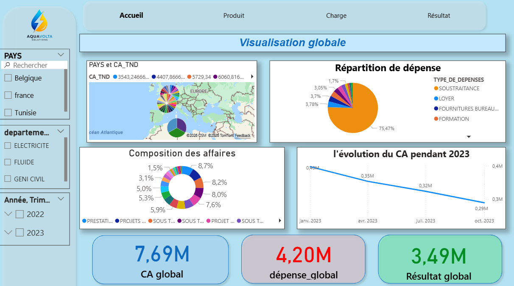
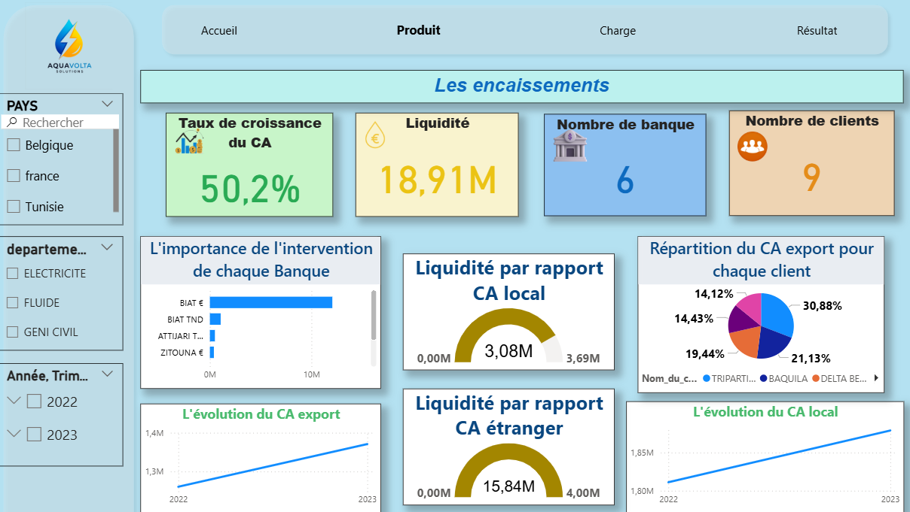
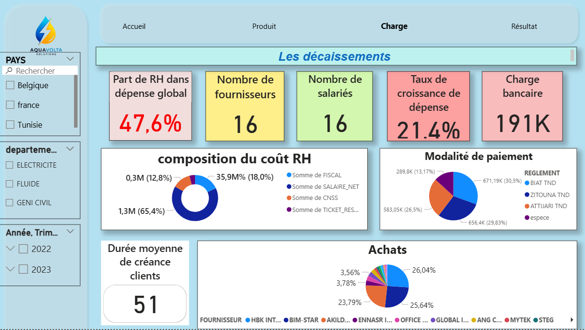
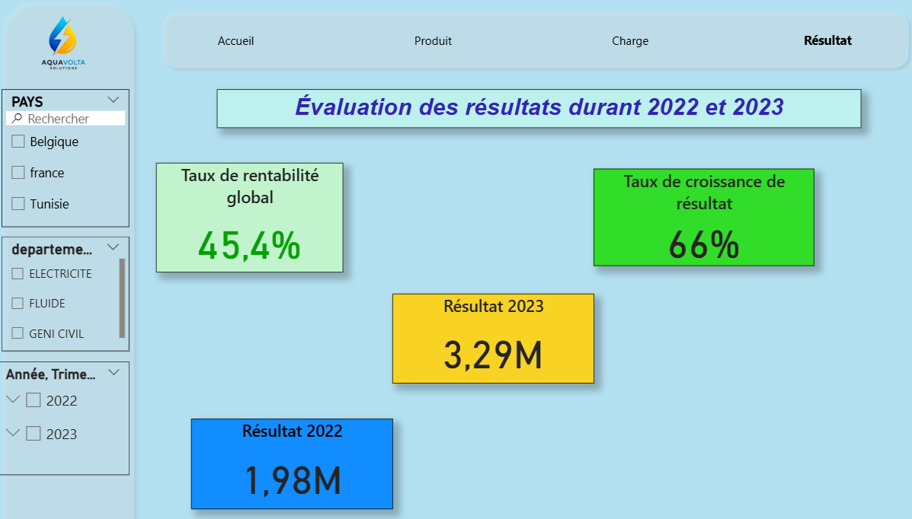

# Power BI report

**Published report:** <https://app.powerbi.com/view?r=eyJrIjoiZWNjNjk5YWQtYThlOC00YmQwLWExNWYtZGQxMzkzMDEzOTYyIiwidCI6ImRiZDY2NjRkLTRlYjktNDZlYi05OWQ4LTVjNDNiYTE1M2M2MSIsImMiOjl9>

The same URL is embedded in the web application (`app/src/components/Header.tsx`, "Dashboard" button).

## Why `visualisation.pbix` is not in this repository

A `.pbix` file in import mode contains a compressed copy of every imported table. Publishing it would publish the company's financial records. The file is excluded by `.gitignore`.

## Screenshots

| | |
|---|---|
|  |  |
|  |  |

Headline figures shown (both years, no filter): global revenue 7.69 M, global expenses 4.20 M, global result 3.49 M; result 1.98 M in 2022 and 3.29 M in 2023; revenue growth 50.2 %; 9 clients, 6 banks, 16 suppliers, 16 employees. The collection-related figures are affected by the error noted below.

## Report structure

Extracted from the report layout of `visualisation.pbix` (page size 1280 × 720):

| Page | Visuals |
|---|---|
| **Accueil** | 3 cards, pie chart, donut chart, line chart, Azure map, 3 slicers, page navigator |
| **Produit** | 4 cards, 2 gauges, clustered bar chart, 2 line charts, pie chart, 3 slicers, page navigator |
| **Charge** | 5 cards, 1 card (new visual), 2 pie charts, donut chart, 3 slicers, page navigator |
| **Résultat** | 4 cards, 3 slicers, page navigator |

## Data source

The model reads the MySQL warehouse `data_war_house`. Tables referenced by visuals: `date_d`, `local_d`, `export_d`, `depense_d`, `departement_d`, `encaissement_d`, `salaire_d`. No visual references `fact_tabel`.

Slicing fields include date (year, quarter, month), country (`PAYS`) and department.

## Measures and calculated fields referenced by the visuals

`CA global`, `CA étranger`, `TC CA`, `dépense_global`, `TC depense`, `Résultat global`, `résultat 2022`, `résultat 2023`, `TC de résultat`, `taux de rentabilité`, `total encais`, `recouvrement tnd`, `recouv étranger`, `durée moyenne de créance client`, `charge bancaire`, `part`, `nb client`, `nb banque`, `Nbre de feur`, `nbre de SALARIE`.

Only the names are listed. Their DAX definitions are stored in the compressed data model and were not extracted, so no formula is reproduced here. To document them, open the file in Power BI Desktop and copy each measure definition, or export the model with Tabular Editor / DAX Studio.

## Reproducing the report

1. Create and load the `data_war_house` database (see `database/README.md`).
2. In Power BI Desktop, connect to MySQL (requires the MySQL Connector/NET driver) and select the tables above.
3. Recreate the measures and pages, or open the original `.pbix` and repoint the data source.

## Confidentiality of the published report

The link above is a **Publish to web** link. It requires no sign-in, can be opened and re-shared by anyone who has the URL, and is embedded in the public web application. The report is built on real company data, so its cards and charts disclose real aggregated figures, and slicers allow those aggregates to be narrowed. Not publishing the `.pbix` file does not change this.

In addition, the warehouse table the report reads (`export_d`) contains the confirmed 2023 export collection error (`analytics/calculation-audit.md`, F1), so the report's 2023 export collection figures are expected to be overstated. Screenshots supplied by the author confirm it: on the *Produit* page, collections compared with foreign revenue read 15.84 M against 4.00 M, and the liquidity card reads 18.91 M against a global revenue of 7.69 M.

Recommended target, detailed in [docs/security-and-privacy.md](../docs/security-and-privacy.md#power-bi-publication):

1. **Portfolio report** — same pages on an anonymised or synthetic dataset, labelled as such; this is the one to publish publicly.
2. **Company report** — real data in a Power BI workspace with Microsoft Entra sign-in, row-level security by role, and no public embed code.
3. **Power BI Embedded** — only if the report must appear inside the web application for authenticated users.

The link is kept here because it is the project's delivered dashboard; removing or replacing it is the owner's decision.
