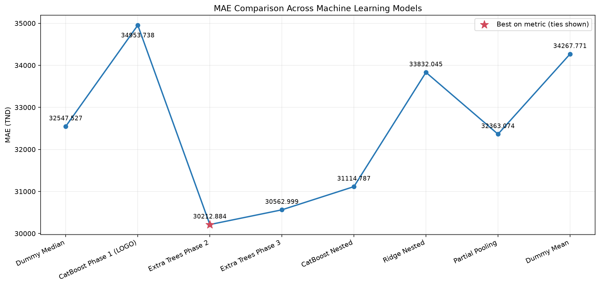
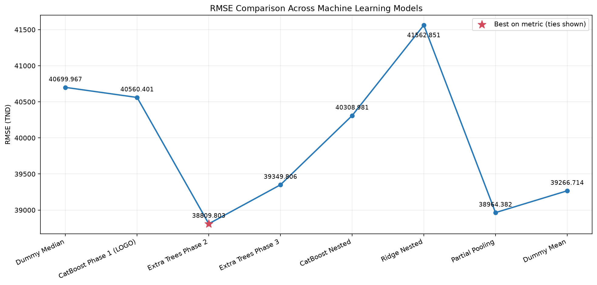
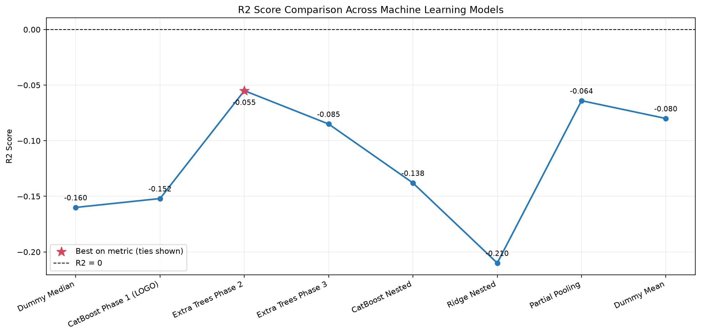
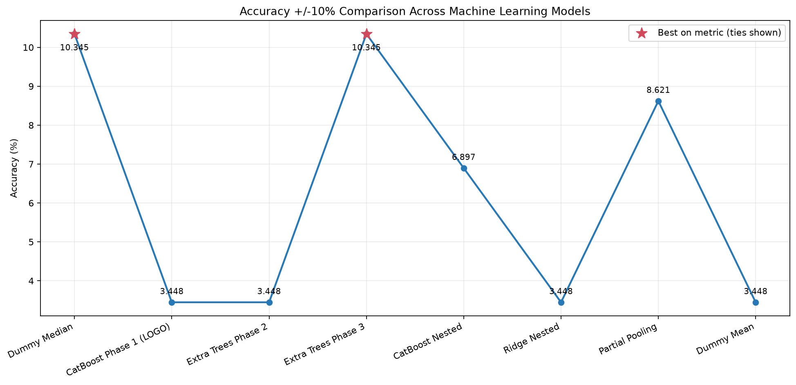

# Prediction — exploratory modelling of export revenue

Last stage of the BI process: an exploratory machine-learning study on the warehouse data.

> **Status: exploratory — not an operational forecast.** Under honest validation, no model reliably beats a naive baseline (R² is negative for every candidate). The time-series forecasting of financial flows and of foreign-exchange losses required by the specification remains `Planned — Future Development Phase`.

## What the notebook does

`prediction_ca_export.ipynb` (originally `pridiction2024+.ipynb`):

1. Connects to the MySQL warehouse `data_war_house` with credentials read from a local `.env` file and loads the tables read-only.
2. Prepares `export_d`: numeric conversion of `CA_TND`, trimming and case-folding of `PAYS` and `departement` (which merges `France` / `france`).
3. Sets the task: predict the amount of an export invoice in TND (`CA_TND`) from two categorical predictors, **country** and **department**. The date is not used as a predictor.
4. Audits the data: 58 invoices (2022-01-05 to 2023-12-23), 8 country–department pairs holding 1 to 12 invoices each; differences between pairs explain 19 % of the variance of the target.
5. Validates with **leave-one-group-out** (one whole country–department pair held out per fold), with encoders, target transform and hyper-parameter search fitted inside the training folds (nested search).
6. Compares Extra Trees, CatBoost, Ridge, a partial-pooling additive model, and two naive baselines (mean, median), on raw and `log1p` targets.
7. Refits the selected model on all rows and saves it locally.

## Results (as executed)

| Model (LOGO validation) | MAE (TND) | RMSE (TND) | R² | Within ±10 % | Macro group MAE (TND) |
|---|---:|---:|---:|---:|---:|
| Extra Trees, phase 2 replay | 30,213 | 38,810 | −0.055 | 3.4 % | 28,924 |
| **Extra Trees, phase 3 tuned (selected)** | 30,563 | 39,350 | −0.085 | 10.3 % | 28,569 |
| CatBoost, nested search | 31,115 | 40,309 | −0.138 | 6.9 % | 27,852 |
| Partial-pooling additive | 32,363 | 38,964 | −0.064 | 8.6 % | 30,451 |
| Baseline — median | 32,548 | 40,700 | −0.160 | 10.3 % | 29,463 |
| Ridge, nested | 33,832 | 41,563 | −0.210 | 3.4 % | 30,706 |
| Baseline — mean | 34,268 | 39,267 | −0.080 | 3.4 % | 30,987 |
| CatBoost, phase 1 configuration | 34,954 | 40,560 | −0.152 | 3.4 % | 33,588 |

| | | |
|---|---|---|
|  |  | |
|  |  | |

## How to read these results

- **R² is negative for every model**: on country–department pairs held out of training, each one does worse than simply predicting the overall average invoice amount. The selected model improves the median baseline's MAE by about 6 %, with an average error of roughly 30,000 TND against an average invoice of about 45,000 TND.
- **About one prediction in ten falls within ±10 %** of the actual amount — the same rate as the median baseline.
- The cause is structural, not a tuning problem: two categorical predictors with eight combinations cannot explain invoice amounts that vary widely *within* each combination, and 58 rows are too few to learn more.
- The phase 1 score (R² = 0.057) did not reproduce under leave-one-group-out validation; the notebook documents this and does not present it as comparable.
- Selecting the best of several candidates on the same eight folds is itself optimistic.

**Conclusion.** The study is a sound negative result: with the present data, invoice-level export revenue cannot be predicted from country and department. The model must not be used for budgeting or reporting.

## Relation to the specification

| Specification | This work |
|---|---|
| Forecast future financial flows with time series | Not addressed: the model is cross-sectional and uses no time information |
| Forecast foreign-exchange losses | Not addressed |
| Forecasts validated by the business | Not applicable |

The target `CA_TND` is not affected by the collection imputation error described in `analytics/calculation-audit.md` (which concerns `Recouvrement`). A model of collections or cash flows would be, until the corrected data is reloaded.

## Reproducing

```bash
pip install -r prediction/requirements.txt
cp prediction/.env.example prediction/.env     # then fill in your local MySQL access
cd prediction && jupyter notebook prediction_ca_export.ipynb
```

A loaded `data_war_house` database is required; its data is confidential and not distributed. The notebook writes the charts and the model file to the working directory.

## What is published and what is not

| Item | Published | Reason |
|---|---|---|
| Notebook code, methodology notes, metric tables, charts | Yes | |
| Outputs printing warehouse rows, per-group amount distributions, per-invoice errors | Removed | They displayed client names and real invoice amounts |
| `.env` | No | Database credentials |
| Model files (`*.joblib`, `*.cbm`) | No | Binary artefacts fitted on confidential data — tree models with one sample per leaf store training amounts — and `joblib` files can execute code when loaded. They are regenerated by running the notebook |
| Backup and unexecuted copies of the notebook | No | Duplicates of the same code |

## Next steps

1. Reload the corrected data, then build monthly series (collections, revenue, expenses, payroll, FX losses).
2. Start from naive and seasonal-naive baselines with time-ordered validation; two years give at most 24 monthly points per series.
3. Add explanatory variables that exist before invoicing (client, project, contract size) if the business can provide them.
